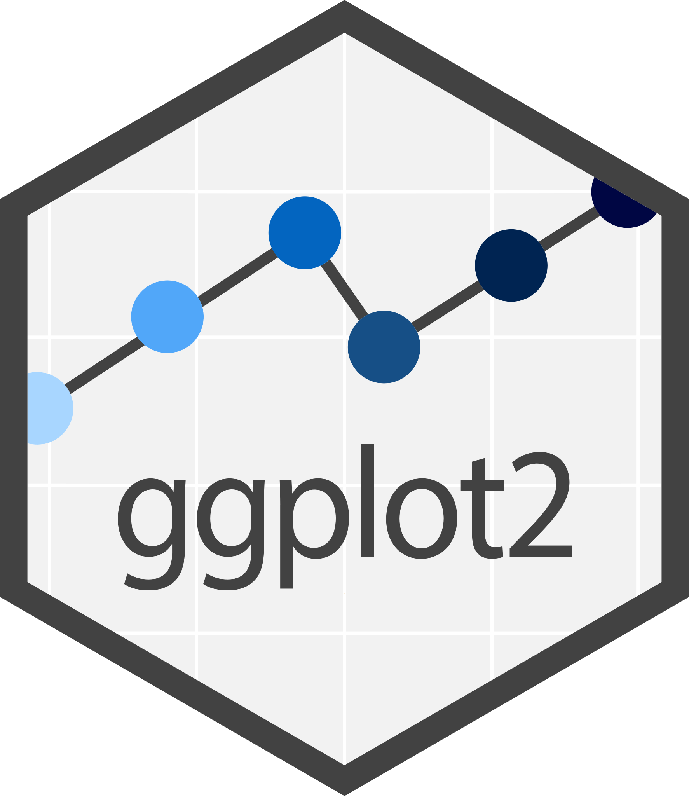
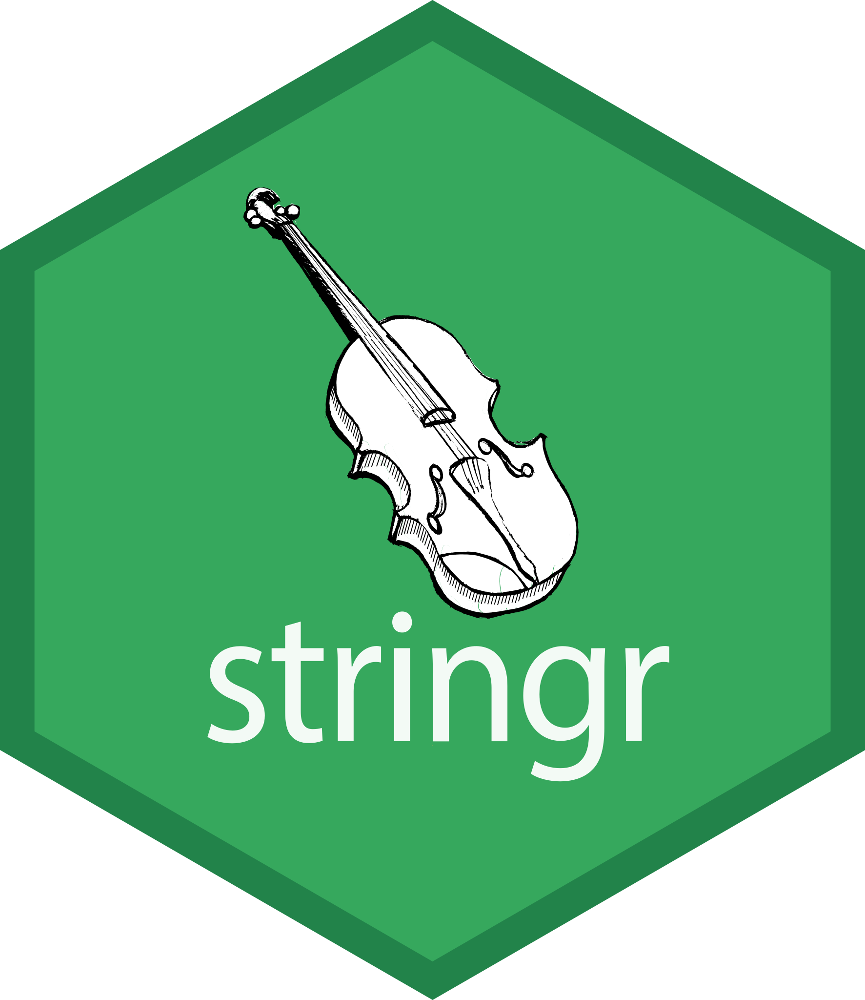
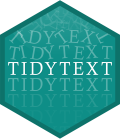

I currently teach INTL 7007, **Data Analytics for International Policy Professionals**, in the Master of International Policy program at the University of Georgia. In this class, we cover:

::: {.tag-list}
- data analysis
- data visualization
- linear models
- LLM-powered coding
- Quarto
- estimation of causal effects
- probability
- quantification of uncertainty
- text as data
:::

```{=html}
<div class="hex-row" role="list" aria-label="Tools we use">
  <span class="hex hex-r" role="listitem" title="R logo © The R Foundation, CC-BY-SA 4.0"><span class="hex-inner"></span></span>
  
  
  
  
  
  
</div>
```

Below, you can find some of the hands-on activities that I use in class.

[Course tutorial site ↗](https://camlivio.github.io/INTL7007/){.cta-secondary}

::: {.stack-items}

::: {.stack-item .b-yellow}
[Week 2]{.week}

### [R Basics & The Weighted Dice](https://camlivio.github.io/INTL7007/dice/)

Your first hour in R. Arithmetic and objects, vectors, functions and their arguments, writing a function of your own, and running a simulation ten thousand times, ending with a pair of dice you have quietly weighted.

[Adapted from Grolemund, *Hands-On Programming with R*, ch. 1–3.]{.source}
:::

::: {.stack-item .b-blue}
[Week 3]{.week}

### [Coding With an LLM, Part I: Prompt It](https://camlivio.github.io/INTL7007/llm/)

Twenty minutes on the one skill that makes AI genuinely useful for code. Students load a 229,444-row dataset and estimate a treatment effect, having been taught neither, and find out why *how* you ask decides whether you get an answer or a fabrication.

[Uses Gerber, Green & Larimer (2008) on social pressure and voter turnout.]{.source}
:::

::: {.stack-item .b-lavender}
[Week 6]{.week}

### [Warming up: Quarto](https://camlivio.github.io/INTL7007/quarto/)

A quick check on a pair-programming task. Take apart a `.qmd` file, fix a broken header, find the one code chunk that actually runs, and predict what the rendered page will look like.

[Reviews Pair Programming 2: Quarto in R.]{.source}
:::

::: {.stack-item .b-yellow}
[Week 10]{.week}

### [ggplot2](https://camlivio.github.io/INTL7007/ggplot/)

Pair-programming activity.

[Based on Wickham, Çetinkaya-Rundel & Grolemund, *R for Data Science* (2e), ch. 1.]{.source}
:::

:::

## The Carpentries {.carpentries-heading}

::: {.carpentries}
<a href="https://carpentries.org/" class="carpentries-logo-link"></a>

I am a certified instructor with [The Carpentries](https://carpentries.org/), a nonprofit that teaches foundational coding and data science skills to researchers worldwide. I regularly use their open, community-developed lessons in my classes.

[Browse Carpentries lessons ↗](https://carpentries.org/lessons/){.cta-secondary}
:::
